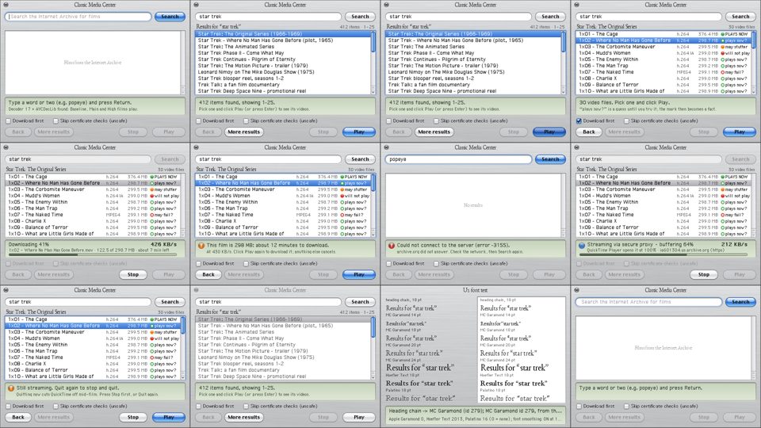
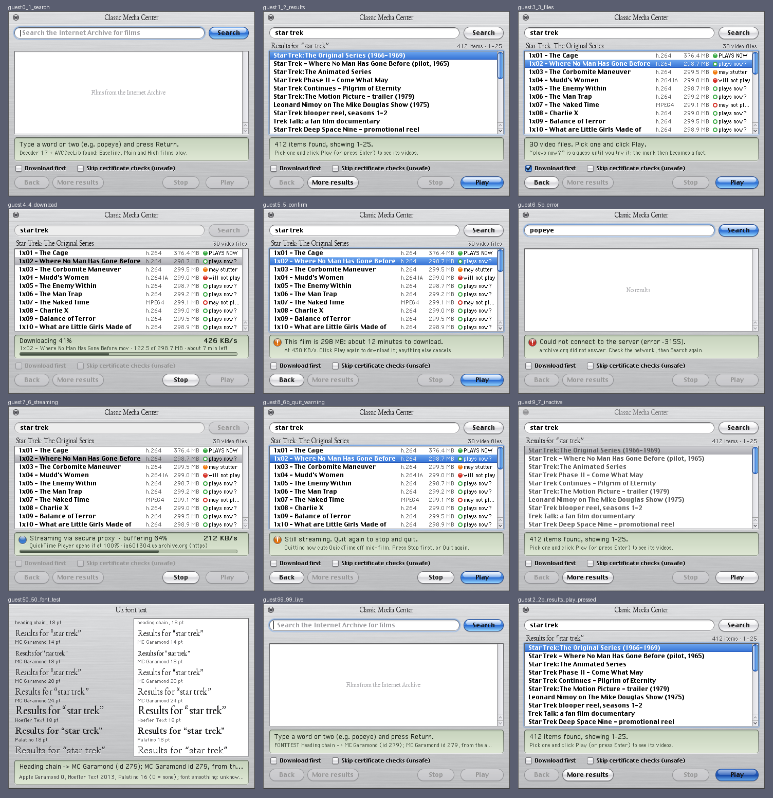

# Classic Media Center

Browse the Internet Archive from a PowerPC Mac running **Mac OS 9**, and watch its
films in **QuickTime Player 6**, including films that archive.org only serves over
**https**.

Classic Media Center is a small classic (non-Carbon) application written in C89 and
built with CodeWarrior Pro 8.3. It searches archive.org, lists an item's video files,
checks whether this Mac can play each one, and hands the film to QuickTime Player:

- **Plain http films stream directly**: Media Center fetches the movie's index (`moov`),
  rewrites it for QuickTime 6, and writes a small *reference movie* on the Desktop whose
  data points at archive.org.
- **https-only films stream through an in-app proxy.** QuickTime 6 cannot speak modern
  TLS, so Media Center runs a tiny HTTP server on `127.0.0.1:8080` and fetches the film
  over TLS 1.2/1.3 with **macTLS** (BearSSL). QuickTime reads plain http from Media
  Center; Media Center reads https from archive.org.
- **Download first** (a checkbox) fetches the whole film to disk instead.
- Main/High profile films with B-frames are rewritten so that QuickTime 6, which cannot
  reorder pictures, shows every picture on time (`AVCReorder.c`).

It needs the H.264 decoder for QuickTime 6 from
[smithwicks-red/h264-classic](https://github.com/smithwicks-red/h264-classic):
**H264 Decoder 17d + AVCDecLib** for Main/High profile (the older v15 decoder plays
Baseline only, and Media Center tells you so).

## Status: 0.6.1 (27 November 2026)



0.6.1 is a small update to 0.6 (the QuickTime Player 6 style window, described below):

- **Second play fixed.** The reference movie keeps its " (MC).mov" tail (a second play
  of a film makes "name 2 (MC).mov", at most 31 characters), and our own old one is
  reused when QuickTime no longer has it open, so Stop and Quit can close QuickTime's
  window by name.
- **KB/s** is an 8-second average and never shows "0 KB/s"; while QuickTime rests the
  display says "buffered".
- **Look:** Geneva for rows and buttons, "may fail?" / "old decoder?" instead of
  "may not play?", and technical log lines no longer show on the LCD.
- **G3-aware playback.** On a G3 (Gestalt CPU type and clock) each H.264 file gets a
  budget check from its macroblocks per second (size x frame rate, weighted for profile
  and B-frames). Rows are marked "may stutter" or "too heavy". If a lighter rendition of
  the same film exists (same Internet Archive "original", for example a 320x240 MPEG-4
  file), that one plays and the LCD says so. A stream that the network cannot keep up
  with is downloaded first. The "Download first" hint is no longer given for a jerky
  picture on a G3, which is the CPU. G4 behaviour is unchanged. The constants are first
  guesses; see `mediacenter/BUILD_NOTES_061.md`.
- **Creator code** is `CMdC`; the About box, log and user agent say 0.6.1.

**Not yet tested on real hardware:** the G3 policy and its numbers, a second play while
QuickTime still holds the first reference movie, and the switch to a lighter file. They
were proved on a Linux rig (x86-64 with sanitizers, and PowerPC under qemu).

### 0.6: the new look (22 November 2026)



0.6 replaces the plain dialog of 0.4/0.5 with a window in the style of QuickTime
Player 6: brushed metal, Aqua gel buttons, an inset list, a grey-green "LCD" status
display with a progress bar, and Garamond-style headings. Mac OS 9 has no brushed-metal
or Aqua controls, so the app draws all of it itself: a portable C89 painter
(`mc_skin`, `mc_layout`) paints into a 32-bit offscreen GWorld, QuickDraw adds the text,
and only the changed rectangles are copied to the window.

- **Headings** use *MC Garamond*, a condensed EB Garamond bundled in the application's
  resource fork (SIL Open Font License, see `font/`). If Apple Garamond is installed it
  is used instead; the fallbacks are Hoefler Text, then Palatino.
- **The status display** shows search and download progress, the streaming buffer,
  KB/s and the upstream server, and warnings (for example the second-Quit warning)
  without modal alerts.
- **Keys:** Return searches from the field and plays from the list; Enter and Cmd-P
  play; Tab moves between the field and the list; arrows, Page Up/Down and Home/End move
  in the list; Esc and Cmd-. cancel a search or download, or go back, and never quit.
  Quit is Cmd-Q, File > Quit or the round close button.
- Files that this Mac may not play smoothly get an orange "may stutter" mark.
- Below Thousands of colours (or if there is not enough memory for the offscreen image)
  the 0.5 dialog is used.

Tested on a **Mac mini G4** (real hardware) and in a QEMU/UTM Mac OS 9.2.2 VM: search,
Main-profile B-frame films over plain http, and an https-only 306 MB 640x480 film
streamed through the in-app proxy (about 159 MB served at about 390 KB/s on the Mini),
Stop, and Quit while streaming.

Streaming itself is unchanged from 0.5u:

- https-only archive.org films stream through the in-app proxy; plain http films stream
  directly from archive.org to QuickTime.
- Play, pause and seeking **within the part already downloaded** work. QuickTime 6
  never asks for a later part of an http movie on a seek, so you cannot jump past what
  has arrived.

Known issues in 0.6.1:

- The untested items listed above.
- In the VM (not on real hardware) QuickTime ignores Stop's request to close the window.

## Requirements and settings

- A PowerPC Mac with Mac OS 9.2.2, QuickTime 6.0.x, Open Transport.
- **640x480 needs a G4** (AltiVec, through AVCDecLib). On a G3, 0.6.1 marks files by
  their size and frame rate (320x240 should play; 480x360 may stutter; 640x480 is too
  heavy) and prefers a lighter rendition; these limits are not yet measured on real G3
  hardware.
- **Memory (important):**
  - Media Center: Get Info > Memory, Preferred **9216 K**, Minimum **8192 K**
    (it holds up to 4 MB of the film in RAM before handing it to QuickTime).
  - QuickTime Player: Preferred about **32768 K** for 640x480 films. Its standard
    partition runs out and can freeze the whole Mac.
- Media Center must keep running while a streamed film plays (the film comes through
  it). Quitting while a film streams asks for a second Quit within 10 seconds.

## How the https streaming works (and why it is built this way)

QuickTime 6 opens a reference movie whose data is an http URL **synchronously**: inside
the open call it waits for the connection without letting any other application run.
A server that answers only from its event loop is then starved, and both wait (we saw
an 8-minute freeze, then "cannot be completely downloaded"). So Media Center:

1. fetches the film's start (up to the end of the index plus 512 KB, at most 4 MB) into
   RAM **before** it writes and opens the reference movie ("Buffering N%");
2. answers QuickTime's request from an **Open Transport notifier** (deferred-task time),
   which runs even while QuickTime holds the processor: accept, read the GET, send the
   206 head and the buffered bytes;
3. once QuickTime's open returns, continues the body from its event loop on the same
   (parked) TLS connection.

If a connection drops, QuickTime 6 reconnects with a `Range:` request and the proxy
resumes the upstream from that offset. Details: `mediacenter/BUILD_NOTES_05T.md` and
`BUILD_NOTES_05U.md`.

## Layout

| Path | What |
|---|---|
| `mediacenter/` | The app: `MediaCenter.c` (Toolbox shell and the skin's Mac layer), `mc_ui` (portable UI controller: keys, clicks, focus, the LCD), `mc_layout` + `mc_skin` (portable widget layout and painter), `mc_demo` (demo scenes and the font test), `mc_core` (archive.org search/metadata, playability verdicts), `mc_fetch` (moov probe, rewrite, download), `mc_stream` (streaming policy, pre-buffer, Stop/Quit), `mc_proxy_ot` + `mc_notify` (Open Transport server, notifier state machine), `H264Stream.c`, `AVCReorder.c`; host tests; build notes per version |
| `proxy/` | `mc_proxy`: the portable HTTP proxy core (request parsing, ranges, upstream parking/adoption), with its unit, state-machine and end-to-end tests |
| `tls18/` | `https_client` (HTTP/1.1 over macTLS or plain Open Transport, incl. `HC_Stream`), the macTLS + BearSSL tree, `HTTPSGet` test app, and the host rig that runs the whole app on Linux against local https servers |
| `font/` | MC Garamond: the bundled heading font (`MC Garamond.rsrc`, `MC Garamond.r` for Rez, the TrueType file), `OFL.txt`, `FONTLOG.txt` |
| `docs/screenshots/` | Screens drawn by the app on Mac OS 9 |
| `guest/` | AppleScript/shell helpers used to send sources into a Mac OS 9 VM and build them |

## Building

CodeWarrior Pro 8.3, classic PPC application, no CarbonLib. Put the sources of
`mediacenter/`, `proxy/src/mc_proxy.c/.h` and `tls18/https_client.c/.h` flat in one
project folder with `tls18/mactls/` beside them, and add `font/MC Garamond.rsrc`
(file type `rsrc`) or `font/MC Garamond.r` to the project so the font's `FOND`/`sfnt`
resources (id 279) end up in the application; libraries: InterfaceLib, MSL C (PPC),
OpenTransportLib, OpenTptInternetLib, OpenTransportAppPPC.o, OpenTptInetPPC.o,
QuickTimeLib. Set the partition to 9216 K preferred / 8192 K minimum. The 0.6 steps are
in `mediacenter/BUILD_NOTES_06.md` (0.6.1 changes: `BUILD_NOTES_061.md`), the history in `mediacenter/BUILD_NOTES*.md`.
Tip: close every other project in CodeWarrior before a scripted Make; it acts on the
front project, and it tracks files by alias, so a stale copy elsewhere can be picked up.

Host tests (Linux, gcc, Python 3):

```sh
sh mediacenter/run_tests.sh                       # mc_core, mc_test04, and 0.6.1 mc_test061 (G3 policy)
sh mediacenter/test05/run_mc05_unit.sh            # streaming policy, second-play names, rate average, stream-or-download rule
sh mediacenter/test05t/run_test_mcn.sh            # notifier state machine
sh tls18/host/run_mc05_tests.sh CLIPDIR           # whole app end to end (needs ffmpeg-made clips)
sh mediacenter/test06/run_ui_test.sh              # 0.6 UI controller (x86 + qemu-ppc)
sh mediacenter/test06/run_proof.sh                # skin painter: key map, renders, big-endian check
sh run_all_06.sh CLIPDIR OLD_MEDIACENTER_C        # everything above plus the Toolbox syntax gate
```

## AI use notice

**Most of this project was written by an AI.** The source code, tests, build scripts and
documentation in this repository were written by Claude (Anthropic's AI models), working
in agentic coding sessions. smithwicks-red directed the work: he set
the goals and made the design decisions, ran every test on real Mac OS 9 hardware (a Mac
mini G4) and in his Mac OS 9.2.2 virtual machine, reported what happened, and decided
what to publish.

What that means for you:

- The code was checked by automated tests on Linux (including AddressSanitizer runs and
  big-endian PowerPC emulation) and by hands-on testing on real hardware, but it has not
  had a line-by-line human review. Treat it as you would any young hobby project: it may
  contain mistakes. Such mistakes would be much appreciated in their reporting.
- The bundled third-party code (macTLS, BearSSL, and the TLS 1.3 code adapted from
  Certainly) comes from its own upstream authors under the licences listed below; see
  `tls18/mactls/NOTICES.txt` and `tls18/PATCHES.md` for what was changed here.
- The project's working notes, including dead ends and mistakes, are kept in the
  [h264-classic](https://github.com/smithwicks-red/h264-classic) repository's `docs/`.

Bug reports and corrections are very welcome.

## Licences

- Media Center, mc_proxy, https_client and the host rigs: MIT, see [`LICENSE`](LICENSE).
- macTLS (`tls18/mactls/os9/`): MIT, Copyright (c) 2026 Patrick Britton
  (https://github.com/mplsllc/macTLS). TLS 1.3 code adapted from Certainly: MIT,
  Copyright (c) 2026 Matt Baker. BearSSL (`tls18/mactls/bearssl/`): MIT, Copyright (c)
  2016 Thomas Pornin. Trust anchors derived from the Mozilla CA bundle. See
  `tls18/mactls/NOTICES.txt`.
- `H264Stream.c` and `AVCReorder.c` come from the h264-classic project (MIT).
- MC Garamond (`font/`): SIL Open Font License 1.1. It is a modified (condensed,
  renamed) version of EB Garamond by Georg A. Duffner; see `font/OFL.txt` and
  `font/FONTLOG.txt`. The font may be used and redistributed under the OFL only; it is
  not covered by the MIT licence.

Not affiliated with the Internet Archive. QuickTime and Mac OS are trademarks of Apple.
